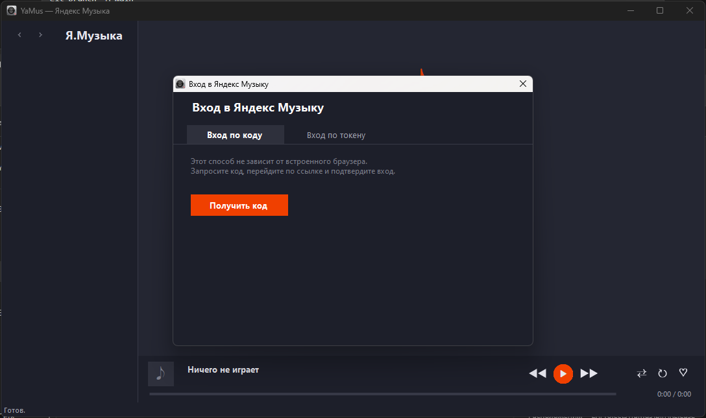
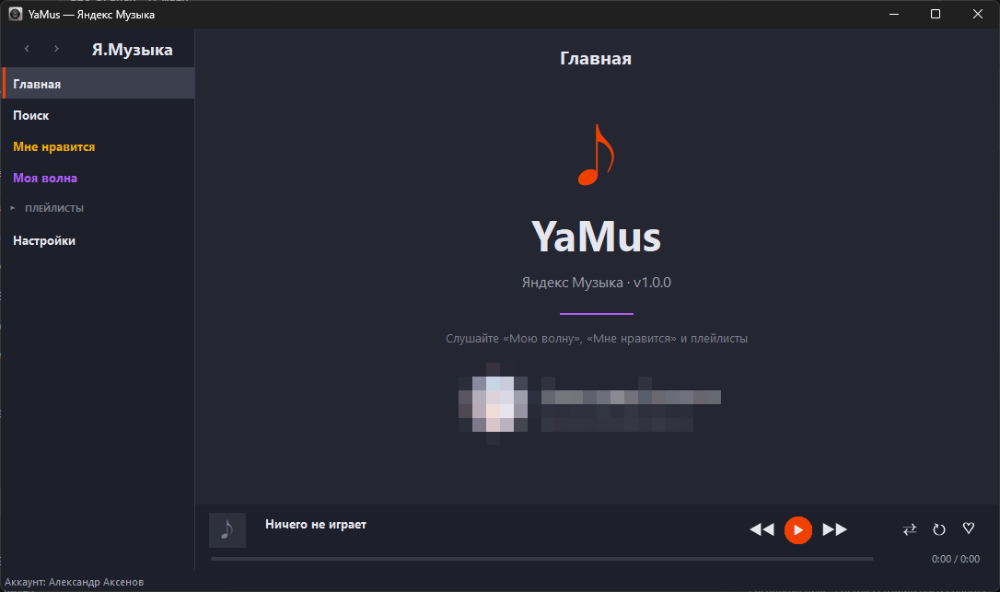

# YaMus

# Русский

YaMus - клиент Яндекс Музыки для Windows XP/7. Исключительно вайбкод, ни капли своего кода.

## Возможности
- Вход по токену/коду OAuth
- Работа без подписки Яндекс Плюс
- Сайдбар (Главная, Поиск, Мне нравится, Моя волна, Плейлисты, Настройки)
- Поиск по трекам, артистам, альбомам
- Рабочая Моя волна по аналогии с оригинальным приложением, возможность запустить Мою волну по треку
- Оверлей подобный оригинальному приложению с градиентом под обложку
- Лайки треков в Мне нравится
- Поддержка трёх тем (чёрная, тёмная, светлая)
- Поддержка выбора качества
- Поддержка медиа-клавиш клавиатуры и Bluetooth-устройств
- Горячие клавиши в оверлее (Пробел, стрелки, F, Esc)
- Переход в альбомы/артистов
- Предзагрузка следующего трека

## Требования
- .NET Framework 4.0
- Windows XP SP3 и выше
- FFmpeg

## Сборка
Используйте `YaMus.sln` в Visual Studio 2019 для сборки.

## Скриншоты

## Лицензия
[MIT License](LICENSE)

---

# English

YaMus is a Yandex.Music client for Windows XP/7. Full vibecode, may contain rough bugs.

## Features
- Sign in via OAuth token or device code
- Works without Yandex Plus subscription
- Sidebar (Home, Search, Likes, My Wave, Playlists, Settings)
- Search for tracks, artists, and albums
- Functional "My Wave" similar to the official app; can start "My Wave" from a track
- Native-like now-playing overlay with cover-based gradient
- Like tracks to "My Likes"
- Three themes (Black, Dark, Light)
- Audio quality selection
- Keyboard media keys and Bluetooth device support
- Overlay hotkeys (Space, Arrow keys, F, Esc)
- Navigate to albums and artists
- Next-track prefetch

## Requirements
- .NET Framework 4.0
- Windows XP SP3 or higher
- FFmpeg

## Build
Use `YaMus.sln` in Visual Studio 2019 to build.

## Screenshots

## License
[MIT License](LICENSE)